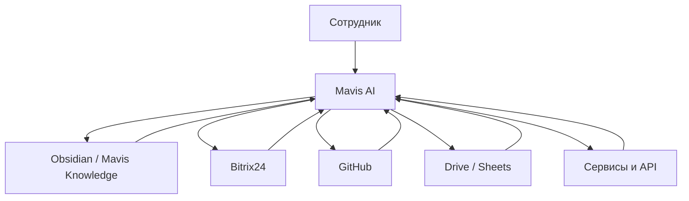

# Архитектура Mavis AI

## Принцип
Obsidian — память и документация.  
Mavis AI — интеллект и оркестрация.  
Bitrix24 — операционная правда по CRM.  
GitHub — правда по коду.  
Drive/Sheets — документы и табличные данные.

## Правило безопасности
Критичные изменения:
- production-код;
- настройки Bitrix;
- удаление данных;
- изменение регламентов

должны проходить через подтверждение человека.
